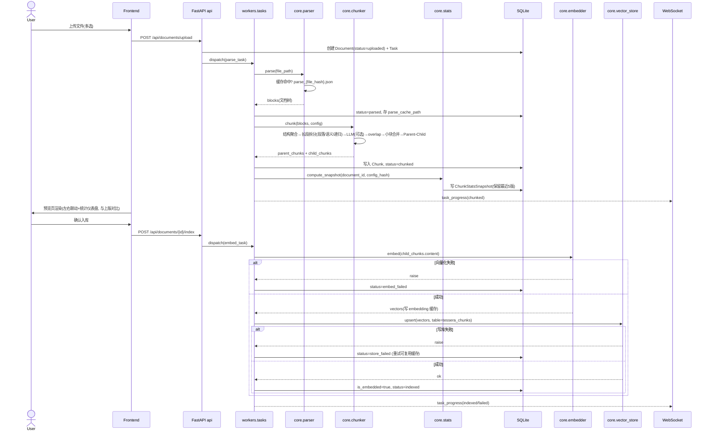
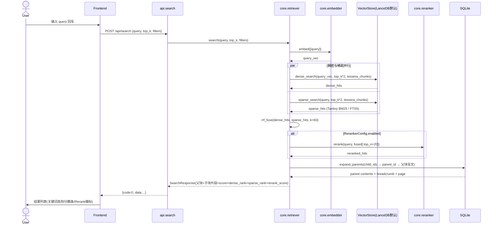
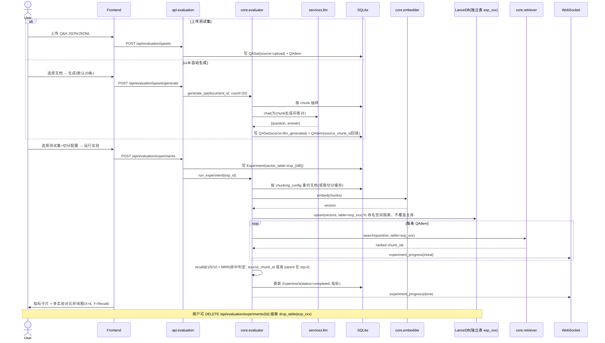
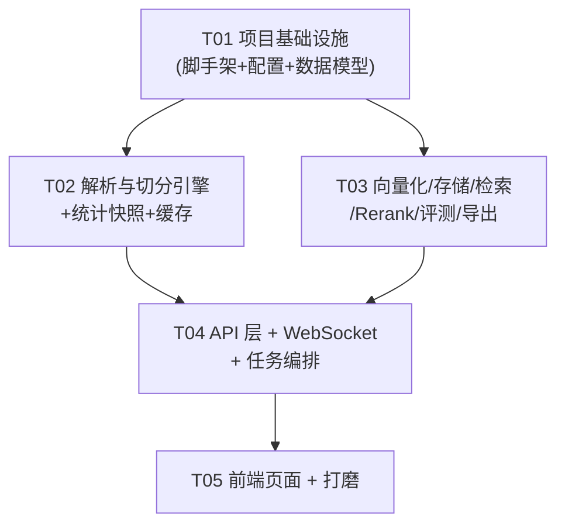

# Tessera 系统设计文档（DESIGN）

> 架构师：高见远（Gao） | 版本：v0.1 | 依据：PRD.md + ARCHITECTURE.md + 主理人 7 项修订决策
> 本文档在 ARCHITECTURE.md 基础上输出最终设计，**所有变更点均以「变更」标注并给出理由**。

---

## Part A：系统设计

## 1. 实现方案与框架选型

### 1.1 主理人修订决策落实总览（变更点清单）

| # | 变更点 | ARCHITECTURE.md 原方案 | 最终方案 | 理由 |
|---|--------|----------------------|---------|------|
| 1 | 向量库默认档 | Chroma | **LanceDB** | 原生 Tantivy BM25 全文索引 + 向量混合检索 + 内置 reranker API；嵌入式零服务；Apache-2.0 |
| 2 | 向量库兜底档 | NumpyStore（.npy 暴力余弦） | **sqlite-vec** | FTS5 与向量共存同一 .db 文件；单文件零依赖；稀疏/稠密同库后 RRF 在应用层融合 |
| 3 | 降级链 | Chroma 失败 → NumpyStore | **LanceDB 初始化失败 → 自动降级 sqlite-vec 并提示** | 保证任何环境可启动 |
| 4 | Embedding 模型 | BGE-M3 + OpenAI 兼容 API | **BGE-M3 默认 + Qwen3-Embedding（0.6B/4B 可选下载）+ OpenAI 兼容 API** | 给低显存/高要求用户分档选择 |
| 5 | 检索链路 | 稠密+稀疏 → RRF → 父块展开 | **稠密+稀疏 → RRF → Rerank（bge-reranker-v2-m3，仅 top 20）→ 父块展开** | 本地 rerank 提升精度；设置页可开关；模型按需下载 + WS 进度 |
| 6 | 评测 | 无 | **新增 evaluator 模块**：Q&A 上传/LLM 生成（每文档默认 20 条）、Recall@k（1/5/10）+ MRR、实验持久化、多实验对比折线图、**每组实验独立 LanceDB 表（命名空间隔离），可手动删除** | 切分调参数据驱动 |
| 7 | 统计 | 无 | **新增 stats 模块**：token 直方图 + 类型占比 + 均值/中位数；每次重切持久化快照（保留最近 5 版），默认与上一版同屏对比 | 调参前后分布可对比 |
| 8 | 导出 | 无 | **新增 exporter 模块**：JSONL 导出，alpaca（LLaMA-Factory）+ Dify 双模板，章节勾选过滤 | 微调工程师下游使用 |
| 9 | 状态机 | embed_failed | **拆分为 embed_failed（向量化失败）/ store_failed（写库失败）** | store_failed 重试可直接复用 embedding 缓存跳过重算 |

### 1.2 核心技术挑战与对策

| 挑战 | 对策 |
|------|------|
| 八阶段切分算法正确性（结构/语义/递归兜底） | 自研 chunker 流水线，阶段间纯函数式传递 Block/Chunk 列表；核心模块强制单元测试 |
| 本地大模型懒加载 + 按需下载 + 进度展示 | `services/model_manager.py` 统一封装 HuggingFace `snapshot_download`，下载进度经 WebSocket 推送；Embedder/Reranker 懒加载单例 |
| 多后端混合检索统一 | `VectorStore` 抽象基类，四实现；稀疏检索能力差异在工厂层屏蔽（见 1.4） |
| CPU 密集任务不阻塞事件循环 | ProcessPoolExecutor（Windows spawn），`workers/pool.py` 封装；IO 密集走 asyncio |
| 实验索引互不覆盖 | 每组实验写独立 LanceDB 表 `exp_{exp_id}`；主库固定表 `tessera_chunks` |
| Windows 中文路径 | 全链路 pathlib + UTF-8；`if __name__ == "__main__"` 保护 |

### 1.3 框架与库选型（含新增）

- **Docling**（MIT）：多格式统一解析为文档树 —— 不变
- **FlagEmbedding**：BGE-M3 本地稠密+稀疏权重 —— 不变
- **sentence-transformers / transformers**：Qwen3-Embedding 与 bge-reranker-v2-m3 加载 —— **新增**
- **LanceDB + tantivy**（Apache-2.0）：默认向量库，原生 FTS 与混合检索 —— **新增（替换 Chroma）**
- **sqlite-vec**：兜底向量库 —— **新增（替换 NumpyStore）**
- **qdrant-client / psycopg[binary]+pgvector**：中/大档 —— 不变
- **FastAPI + SQLAlchemy 2.0 async + Pydantic v2 + SQLite**：不变
- **前端 React 18 + TS + Vite + Tailwind + shadcn/ui + Zustand + TanStack Query**：不变
- **Recharts**：直方图 / 饼图 / 折线图 —— **新增**（React 生态主流，API 声明式，满足统计仪表盘与评测对比图）

架构模式：后端经典四层（api / core / services / models）；前端 Container-Presentational + Zustand（客户端状态）+ TanStack Query（服务端状态）。

### 1.4 各向量库混合检索实现（变更后）

| 后端 | 稠密检索 | 稀疏检索 | 融合位置 |
|------|---------|---------|---------|
| sqlite-vec（兜底） | vec0 虚拟表 KNN | **同库 FTS5 BM25** | 应用层 RRF |
| LanceDB（默认） | 原生 ANN | **原生 Tantivy BM25**（content 建 FTS 索引） | LanceDB 原生 hybrid；不足时应用层 RRF 兜底 |
| Qdrant | 稠密向量 | 原生稀疏向量（BGE-M3 lexical_weights） | 服务端 RRF |
| pgvector | HNSW | tsvector 全文 | SQL 层 RRF |

约束：BGE-M3 稀疏权重仅 Qdrant/pgvector 使用；LanceDB/sqlite-vec 稀疏路走各自 FTS；API Embedding 仅有稠密向量，稀疏路同上。Rerank 统一在**应用层**、RRF 之后执行，与后端无关。

---

## 2. 文件列表

```
tessera/
├── backend/
│   ├── pyproject.toml
│   ├── app/
│   │   ├── __init__.py
│   │   ├── main.py                    # FastAPI app + lifespan（启动降级检测、任务恢复扫描）
│   │   ├── config.py                  # pydantic-settings 环境变量
│   │   ├── database.py                # SQLAlchemy async engine/session
│   │   ├── api/
│   │   │   ├── __init__.py
│   │   │   ├── documents.py           # 上传/列表/详情/删除/重解析/解锁/批量
│   │   │   ├── chunks.py              # 切分触发/结果查询/重切/确认入库
│   │   │   ├── parse_preview.py       # 【新增 08-12】解析块列表/质量报告/LLM 清洗/版本切换
│   │   │   ├── search.py              # 检索测试
│   │   │   ├── evaluation.py          # 【新增】Q&A 集管理 + 实验运行/历史/删除
│   │   │   ├── export.py              # 【新增】JSONL 导出
│   │   │   ├── stats.py               # 【新增】切分统计快照（含与上版对比）
│   │   │   ├── settings.py            # LLM/Embedding/Reranker/向量库/切分/存储/缓存
│   │   │   └── ws.py                  # WebSocket（任务进度/模型下载/实验进度）
│   │   ├── core/
│   │   │   ├── parser.py              # Docling 封装（加密PDF/扫描件OCR）
│   │   │   ├── cleaner.py             # 【新增 08-12】LLM 清洗后处理（文本清洗/表格增强，块 1:1 映射）
│   │   │   ├── quality.py             # 【新增 08-12】解析质量检测（4 类警告 + 统计摘要）
│   │   │   ├── chunker.py             # 八阶段主编排
│   │   │   ├── structure.py           # 结构聚合
│   │   │   ├── semantic.py            # 语义断崖切分
│   │   │   ├── recursive.py           # 递归字符兜底
│   │   │   ├── llm_chunker.py         # LLM 边界合并 + 摘要增强
│   │   │   ├── parent_child.py        # 父子关系构建
│   │   │   ├── embedder.py            # 【变更】Embedder 抽象 + Local(BGE-M3/Qwen3)/API 实现 + 模型注册表
│   │   │   ├── reranker.py            # 【新增】bge-reranker-v2-m3 本地 rerank
│   │   │   ├── retriever.py           # 【变更】混合检索 + RRF + Rerank + 父块展开
│   │   │   ├── evaluator.py           # 【新增】Recall@k / MRR 计算、实验编排
│   │   │   ├── exporter.py            # 【新增】alpaca / Dify JSONL
│   │   │   ├── stats.py               # 【新增】直方图/类型占比/均值中位数/快照
│   │   │   ├── vector_store.py        # 抽象基类 + 工厂（含 LanceDB→sqlite-vec 自动降级）
│   │   │   └── stores/
│   │   │       ├── __init__.py
│   │   │       ├── lancedb_store.py   # 【新增】默认档
│   │   │       ├── sqlite_vec_store.py# 【新增】兜底档（FTS5+vec0 同库）
│   │   │       ├── qdrant_store.py
│   │   │       └── pgvector_store.py
│   │   ├── models/
│   │   │   ├── db.py                  # ORM：Document/Chunk/Task/Settings/QASet/QAItem/Experiment/ChunkStatsSnapshot
│   │   │   └── schemas.py             # Pydantic v2 请求/响应模型
│   │   ├── services/
│   │   │   ├── llm.py                 # OpenAI 兼容 LLM 客户端（DeepSeek/自定义）
│   │   │   ├── file_storage.py        # 文件存取、hash、磁盘检查
│   │   │   ├── model_manager.py       # 【新增】本地模型按需下载 + 进度回调 + 模型清单
│   │   │   └── cache.py               # 三级缓存 + LRU 淘汰
│   │   └── workers/
│   │       ├── tasks.py               # 任务编排（parse/chunk/embed/evaluate）
│   │       └── pool.py                # ProcessPoolExecutor spawn 封装
│   ├── tests/
│   │   ├── test_chunker.py
│   │   ├── test_structure.py
│   │   ├── test_semantic.py
│   │   ├── test_parent_child.py
│   │   ├── test_retriever.py
│   │   ├── test_evaluator.py          # 【新增】
│   │   └── test_exporter.py           # 【新增】
│   └── data/                          # 运行时数据（gitignore）
├── frontend/
│   ├── package.json
│   ├── vite.config.ts
│   ├── tsconfig.json
│   ├── tailwind.config.ts
│   ├── postcss.config.js
│   ├── index.html
│   ├── src/
│   │   ├── main.tsx
│   │   ├── App.tsx
│   │   ├── router.tsx
│   │   ├── pages/
│   │   │   ├── DocumentsPage.tsx
│   │   │   ├── ParsePreviewPage.tsx   # 【新增 08-12】解析预览页（质量报告+LLM 清洗+版本切换）
│   │   │   ├── ChunkPreviewPage.tsx   # 含统计仪表盘区
│   │   │   ├── SearchPage.tsx         # 含 Rerank 开关状态提示
│   │   │   ├── EvaluationPage.tsx     # 【新增】质量评测页
│   │   │   └── SettingsPage.tsx
│   │   ├── components/
│   │   │   ├── documents/             # UploadZone / DocumentTable / BatchToolbar / PasswordDialog
│   │   │   ├── parse/                 # 【新增 08-12】ParseNavPanel / BlockCard / QualityPanel / CleanDialog
│   │   │   ├── preview/               # SourcePanel / ChunkList / ChunkCard / SectionTree / ParamPanel / StatsDashboard【新增】
│   │   │   ├── charts/                # 【新增】TokenHistogram / TypePieChart / CompareLineChart（Recharts 封装）
│   │   │   ├── search/                # SearchBar / ResultCard / RerankBadge【新增】
│   │   │   ├── evaluation/            # 【新增】TestSetPanel / ExperimentTable / ExperimentCompare
│   │   │   ├── settings/              # LLMProviderDialog / EmbeddingPanel / VectorStorePanel / RerankPanel【新增】/ ChunkingPanel / CachePanel / StoragePanel
│   │   │   ├── export/                # 【新增】ExportDialog（模板选择 + 章节勾选）
│   │   │   ├── common/                # StatusDot / ProgressBar / ConfirmDialog / EmptyState
│   │   │   └── ui/                    # shadcn/ui 组件
│   │   ├── hooks/                     # useWebSocket / useTaskProgress / useDocuments / useChunks / useExperiments【新增】/ useParsePreview【新增 08-12】
│   │   ├── stores/                    # useSettingsStore / usePreviewStore / useTaskStore（Zustand）
│   │   ├── lib/                       # api.ts / ws.ts / utils.ts / constants.ts
│   │   └── types/                     # index.ts（与 schemas.py 对齐的 TS 类型）
├── docker-compose.yml                 # P2
├── .gitignore
└── README.md
```

---

## 3. 数据结构与接口

### 3.1 核心类图（Mermaid classDiagram）

完整图另存于 `docs/class-diagram.mermaid`。

```mermaid
classDiagram
    class Document {
        +str id
        +str filename
        +str file_path
        +str file_hash
        +str file_type
        +int file_size
        +int page_count
        +DocStatus status
        +str title
        +str author
        +str lang
        +str parse_cache_path
        +int chunk_count
        +int embedded_count
        +str error_message
        +str parse_variant  % 【新增 08-12】raw / cleaned（LLM 清洗版）
        +datetime created_at
        +datetime updated_at
    }
    class Chunk {
        +str id
        +str document_id
        +str parent_id
        +int chunk_index
        +str content
        +ChunkType chunk_type
        +list~str~ breadcrumb
        +int page_number
        +int end_page
        +int token_count
        +int char_count
        +str strategy
        +list bbox
        +list~str~ block_ids
        +dict table_data
        +str heading_text
        +str embedding_model
        +bool is_embedded
        +str vector_id
        +datetime created_at
    }
    class Block {
        +str id
        +BlockType type
        +str text
        +int level
        +int page
        +list bbox
        +dict table_data
        +int list_level
    }
    class QASet {
        +str id
        +str name
        +str source
        +str document_id
        +int item_count
        +str file_path
        +datetime created_at
    }
    class QAItem {
        +str id
        +str qa_set_id
        +str question
        +str answer
        +str source_chunk_id
        +dict meta
    }
    class Experiment {
        +str id
        +str name
        +str qa_set_id
        +dict chunking_config
        +str embedding_model
        +str vector_table
        +list~str~ document_ids
        +float recall_at_1
        +float recall_at_5
        +float recall_at_10
        +float mrr
        +ExpStatus status
        +str error_message
        +datetime created_at
        +datetime completed_at
    }
    class ChunkStatsSnapshot {
        +str id
        +str document_id
        +str config_hash
        +int version
        +dict histogram
        +dict type_counts
        +float mean_tokens
        +float median_tokens
        +int chunk_count
        +datetime created_at
    }
    class Task {
        +str id
        +str document_id
        +str task_type
        +str status
        +int progress
        +str message
        +str error
    }
    class Parser {
        +parse(file_path, password) DocTree
    }
    class Chunker {
        +chunk(blocks, config) ChunkResult
        -structure_aggregate()
        -split_long_section()
        -llm_review()
        -apply_overlap()
        -merge_small()
    }
    class Embedder {
        <<abstract>>
        +embed(texts) EmbeddingResult
        +dimensions() int
        +model_name() str
    }
    class LocalEmbedder {
        +ensure_model(progress_cb)
    }
    class APIEmbedder
    class Reranker {
        +enabled bool
        +top_n int
        +ensure_model(progress_cb)
        +rerank(query, candidates) list~ScoredChunk~
    }
    class VectorStore {
        <<abstract>>
        +upsert(items, table)
        +dense_search(query_vec, top_k, filters, table)
        +sparse_search(query, top_k, filters, table)
        +delete_by_document(doc_id, table)
        +drop_table(table)
        +health() bool
    }
    class LanceDBStore
    class SqliteVecStore
    class QdrantStore
    class PgVectorStore
    class Retriever {
        +search(query, top_k, filters, table) SearchResponse
        -rrf_fuse(dense, sparse, k)
        -expand_parents(hits)
    }
    class Evaluator {
        +generate_qa(document_id, count) QASet
        +run_experiment(exp_id) Experiment
        -recall_at_k(ranks) dict
        -mrr(ranks) float
    }
    class Exporter {
        +export_jsonl(document_ids, fmt, sections) Path
    }
    class StatsService {
        +compute_snapshot(document_id, config_hash) ChunkStatsSnapshot
        +get_with_previous(document_id) CompareResult
    }
    class ModelManager {
        +ensure_model(model_id, progress_cb) Path
        +status(model_id) ModelStatus
    }
    class LLMClient {
        +chat(messages, **kw) str
        +test_connection() bool
    }

    Document "1" --> "*" Chunk
    Chunk "1" o-- "*" Chunk : parent-child
    Parser ..> Block : produces
    Chunker ..> Block : consumes
    Chunker ..> Chunk : produces
    Chunker --> LLMClient : optional
    Embedder <|-- LocalEmbedder
    Embedder <|-- APIEmbedder
    VectorStore <|-- LanceDBStore
    VectorStore <|-- SqliteVecStore
    VectorStore <|-- QdrantStore
    VectorStore <|-- PgVectorStore
    Retriever --> Embedder
    Retriever --> VectorStore
    Retriever --> Reranker : optional
    Evaluator --> Retriever
    Evaluator --> VectorStore : isolated table
    Evaluator --> Experiment
    Evaluator --> LLMClient : QA generation
    QASet "1" --> "*" QAItem
    Experiment "*" --> "1" QASet
    StatsService ..> ChunkStatsSnapshot
    Exporter ..> Chunk
    LocalEmbedder --> ModelManager
    Reranker --> ModelManager
```



### 3.2 新增数据表字段定义

**QASet**（测试集）

| 字段 | 类型 | 说明 |
|------|------|------|
| id | str (UUID) | 主键 |
| name | str | 名称 |
| source | str | `upload` / `llm_generated` |
| document_id | str, 可空 | LLM 生成时关联的文档 |
| item_count | int | 条目数 |
| file_path | str | 原始上传文件/生成结果落盘路径 |
| created_at | datetime | |

**QAItem**

| 字段 | 类型 | 说明 |
|------|------|------|
| id | str (UUID) | 主键 |
| qa_set_id | str (UUID) | 外键，级联删除 |
| question | text | 问题 |
| answer | text | 参考答案 |
| source_chunk_id | str, 可空 | 生成时对应的源 chunk（LLM 生成时回填，用于判定命中） |
| meta | JSON | 扩展（章节路径、页码等） |

索引：qa_set_id。

**Experiment**（评测实验）

| 字段 | 类型 | 说明 |
|------|------|------|
| id | str (UUID) | 主键 |
| name | str | 实验名（默认 `exp_{时间}`） |
| qa_set_id | str (UUID) | 使用的测试集 |
| chunking_config | JSON | 本次切分配置快照 |
| embedding_model | str | 使用的 embedding 模型 |
| vector_table | str | 独立 LanceDB 表名 `exp_{id前8位}` |
| document_ids | JSON | 参与文档列表 |
| recall_at_1 / recall_at_5 / recall_at_10 | float | 指标 |
| mrr | float | 指标 |
| status | str | pending / running / completed / failed |
| error_message | str | |
| created_at / completed_at | datetime | |

删除实验时级联 `drop_table(vector_table)` 清理索引。

**ChunkStatsSnapshot**（切分统计快照，每文档保留最近 5 版）

| 字段 | 类型 | 说明 |
|------|------|------|
| id | str (UUID) | 主键 |
| document_id | str (UUID) | 外键，级联删除 |
| config_hash | str | 切分参数 hash（与切分缓存同口径） |
| version | int | 单调递增版本号 |
| histogram | JSON | `[{bin_start, bin_end, count}, ...]`（按 token 数分桶） |
| type_counts | JSON | `{text: n, table: n, code: n, image: n, heading: n}` |
| mean_tokens / median_tokens | float | |
| chunk_count | int | |
| created_at | datetime | |

索引：(document_id, version)。插入新快照后删除该文档 version 最旧且超出 5 版的记录。

**Settings 变更**：

```json
// VectorStoreConfig.backend 枚举变更：sqlite_vec / lancedb / qdrant / pgvector
// EmbeddingConfig 增加：
{
  "provider_type": "local",              // local / openai_compatible
  "model_name": "BAAI/bge-m3",           // bge-m3 / qwen3-embedding-0.6b / qwen3-embedding-4b / 自定义 API model
  "dimensions": 1024                     // qwen3-embedding-4b 为 2560
}
// 【新增】RerankerConfig：
{
  "enabled": false,
  "model_name": "BAAI/bge-reranker-v2-m3",
  "top_n": 20
}
```

**状态机枚举（变更）**：`uploaded / parsing / parsed / chunking / chunked / embedding / indexed / encrypted / parse_failed / chunk_failed / embed_failed / store_failed`。
重试语义：`store_failed` 重试直接复用 embedding 缓存重写库；`embed_failed` 重试重新向量化。

### 3.3 新增 API

- `POST /api/evaluation/qasets` — 上传 Q&A 测试集（JSON/JSONL）
- `GET /api/evaluation/qasets` / `DELETE /api/evaluation/qasets/{id}` — 列表/删除
- `POST /api/evaluation/qasets/generate` — LLM 自动生成（body: document_id, count=20）
- `POST /api/evaluation/experiments` — 运行实验（body: qa_set_id, document_ids, chunking_config）
- `GET /api/evaluation/experiments` — 实验历史列表（含指标）
- `DELETE /api/evaluation/experiments/{id}` — 删除实验并 drop 独立表
- `GET /api/documents/{id}/chunk-stats?compare=prev` — 统计快照（默认附带上一版对比）
- `POST /api/export/jsonl` — JSONL 导出（body: document_ids, format: alpaca|dify, sections）
- `POST /api/settings/reranker/test` — Reranker 连通性/加载测试
- `GET /api/settings/models` — 本地模型清单与下载状态
- `POST /api/settings/models/download` — 触发模型下载（WS 推进度）
- **【新增 08-12】解析预览链路**：
  - `GET /api/documents/{id}/blocks?variant=raw|cleaned` — 解析块列表（全量，返回前挂 breadcrumb）
  - `GET /api/documents/{id}/parse-report?variant=raw|cleaned` — 解析质量报告（统计摘要 + 4 类警告 + LLM 清洗 token 预估）
  - `POST /api/documents/{id}/clean` — 触发 LLM 清洗（后台任务 task_type=clean，WS 推送进度）
  - `POST /api/documents/{id}/parse-variant` — 切换 raw/cleaned 解析版本，切换后自动重切
- WS 频道扩展：`task_progress` / `model_download` / `experiment_progress`

---

## 4. 程序调用流程（Mermaid sequenceDiagram）

完整图另存于 `docs/sequence-diagram.mermaid`。

### 4.1 摄入链路（上传 → 解析 → 切分 → 统计快照 → 确认入库）



### 4.2 检索链路（含 Rerank）



### 4.3 评测链路（独立索引命名空间）



---

## 5. 待明确事项（含假设）

1. **Qwen3-Embedding 默认档位**：提供 0.6B/4B 两档可选下载，**假设默认推荐 0.6B**（低显存友好），4B 标注显存要求后由用户自选（对应 PRD 待确认#1）。
2. **LLM 生成 Q&A 策略**：已按主理人决策定为「按 chunk 抽样、每文档默认 20 条」；抽样策略假设为「均匀覆盖章节 + 跳过 table/image 类 chunk」。
3. **JSONL 模板**：主理人决策为 alpaca（LLaMA-Factory）+ Dify 两种；**假设 sharegpt 模板不做**（PRD 待确认#3），alpaca 的 instruction 默认取 breadcrumb 拼接或留空、output 为 chunk content。
4. **Rerank 模型体积**：bge-reranker-v2-m3（约 2GB+）首次使用按需下载，WS 推 `model_download` 进度；下载失败可重试，不影响检索主链路（自动回退无 rerank）。
5. **实验表磁盘占用**：实验独立表长期累积可能占盘，**假设**实验列表显示各表体积、删除实验即回收；暂不设自动清理上限。
6. **LanceDB 原生 hybrid 与应用层 RRF 的口径**：为与 sqlite-vec/Qdrant/pgvector 保持行为一致，**统一在应用层做 RRF**（LanceDB 仅分别取 dense/FTS 两路结果），reranker 同理统一应用层执行。
7. **统计快照分桶数**：直方图默认 20 桶（按 min~max token 等宽），如后续 UI 需要可调。

---

## Part B：任务分解

## 6. 依赖包列表

### 6.1 backend/pyproject.toml

```toml
[project]
name = "tessera"
version = "0.1.0"
requires-python = ">=3.10"
dependencies = [
    "fastapi>=0.115,<1.0",
    "uvicorn[standard]>=0.30",
    "python-multipart>=0.0.9",          # 文件上传
    "sqlalchemy[asyncio]>=2.0,<3.0",
    "aiosqlite>=0.20",
    "pydantic>=2.6,<3.0",
    "pydantic-settings>=2.3",
    "docling>=2.5",                     # 文档解析（MIT）
    "FlagEmbedding>=1.3",               # BGE-M3 稠密+稀疏
    "sentence-transformers>=3.0",       # Qwen3-Embedding / bge-reranker-v2-m3
    "torch>=2.2",                       # CPU 版即可
    "lancedb>=0.13",                    # 默认向量库（替换 Chroma）
    "tantivy>=0.21",                    # LanceDB FTS 索引依赖
    "sqlite-vec>=0.1",                  # 兜底向量库（替换 NumpyStore）
    "qdrant-client>=1.10",
    "psycopg[binary]>=3.1",             # pgvector 档
    "pgvector>=0.3",
    "httpx>=0.27",                      # OpenAI 兼容 API（LLM/Embedding）
    "tenacity>=8.4",                    # 重试（指数退避）
    "numpy>=1.26",
    "aiofiles>=23.2",
    "huggingface-hub>=0.24",            # 模型按需下载（model_manager）
    "tiktoken>=0.7",                    # token 计数（统计仪表盘口径统一）
]

[project.optional-dependencies]
dev = ["pytest>=8.0", "pytest-asyncio>=0.23", "ruff>=0.5"]
```

### 6.2 frontend/package.json（dependencies 节选）

```json
{
  "dependencies": {
    "react": "^18.3.1",
    "react-dom": "^18.3.1",
    "react-router-dom": "^7.0.0",
    "zustand": "^4.5.0",
    "@tanstack/react-query": "^5.50.0",
    "recharts": "^2.12.0",
    "lucide-react": "^0.400.0",
    "clsx": "^2.1.0",
    "tailwind-merge": "^2.4.0",
    "class-variance-authority": "^0.7.0",
    "@radix-ui/react-dialog": "^1.1.0",
    "@radix-ui/react-dropdown-menu": "^2.1.0",
    "@radix-ui/react-select": "^2.1.0",
    "@radix-ui/react-slider": "^1.2.0",
    "@radix-ui/react-switch": "^1.1.0",
    "@radix-ui/react-tabs": "^1.1.0",
    "@radix-ui/react-checkbox": "^1.1.0",
    "@radix-ui/react-tooltip": "^1.1.0"
  },
  "devDependencies": {
    "vite": "^5.3.0",
    "@vitejs/plugin-react": "^4.3.0",
    "typescript": "^5.5.0",
    "tailwindcss": "^3.4.0",
    "postcss": "^8.4.0",
    "autoprefixer": "^10.4.0",
    "@types/react": "^18.3.0",
    "@types/react-dom": "^18.3.0"
  }
}
```

## 7. 任务列表（按实现顺序，遵循 Phase 1 → 2 → 3 → 4）

> 共 5 个任务。T02/T03 在 T01 完成后可并行；T04 依赖 T02+T03；T05 依赖 T04。

| Task ID | 任务名 | 涉及文件 | 依赖 | 优先级 |
|---------|--------|---------|------|--------|
| **T01** | 项目基础设施（脚手架 + 配置 + 数据模型 + 入口） | backend/pyproject.toml、app/main.py、app/config.py、app/database.py、app/models/db.py、app/models/schemas.py、app/workers/pool.py；frontend/package.json、vite.config.ts、tsconfig.json、tailwind.config.ts、postcss.config.js、index.html、src/main.tsx、src/App.tsx、src/router.tsx、src/lib/api.ts、src/lib/ws.ts、src/lib/constants.ts、src/types/index.ts；.gitignore、README.md、docker-compose.yml（骨架） | — | P0 |
| **T02** | Phase 1：解析与八阶段切分引擎 + 统计快照 + 缓存 | core/parser.py、core/chunker.py、core/structure.py、core/semantic.py、core/recursive.py、core/llm_chunker.py、core/parent_child.py、core/stats.py、services/file_storage.py、services/cache.py、services/llm.py；tests/test_chunker.py、test_structure.py、test_semantic.py、test_parent_child.py | T01 | P0 |
| **T03** | Phase 1→2：向量化/四档存储/混合检索/Rerank/评测/导出引擎 | core/embedder.py、core/reranker.py、core/vector_store.py、core/stores/lancedb_store.py、core/stores/sqlite_vec_store.py、core/stores/qdrant_store.py、core/stores/pgvector_store.py、core/retriever.py、core/evaluator.py、core/exporter.py、services/model_manager.py；tests/test_retriever.py、test_evaluator.py、test_exporter.py | T01（与 T02 并行，集成口径以 T01 模型为准） | P0 |
| **T04** | Phase 2：API 层 + WebSocket + 任务编排 | api/documents.py、api/chunks.py、api/search.py、api/evaluation.py、api/export.py、api/stats.py、api/settings.py、api/ws.py、workers/tasks.py、main.py（lifespan 完善：降级检测/任务恢复扫描） | T02, T03 | P0 |
| **T05** | Phase 3+4：前端全部页面 + 打磨 | pages/（Documents/ChunkPreview/Search/Evaluation/Settings）、components/（documents/preview/charts/search/evaluation/settings/export/common/ui）、hooks/、stores/；README 完善、单元测试补全、docker-compose.yml 完善 | T04 | P0（评测页/导出/仪表盘组件为 P1 部分，可后做） |

## 8. 共享知识（跨文件约定）

1. **API 响应格式**：统一 `{code, data, message}`；`code=0` 成功。错误码分段：1xxx 通用（1001 参数错误、1002 资源不存在）、2xxx 文档链路（2001 格式不支持、2002 加密 PDF、2003 解析失败、2004 切分失败、2005 向量化失败、2006 写库失败）、3xxx 模型（3001 LLM 连接失败、3002 模型下载失败）、4xxx 存储（4001 向量库连接失败、4002 已自动降级 sqlite-vec）。
2. **文档状态机枚举**：`uploaded / parsing / parsed / chunking / chunked / embedding / indexed / encrypted / parse_failed / chunk_failed / embed_failed / store_failed`。前后端共用同一份常量（frontend `lib/constants.ts` ↔ backend `models/db.py`）。
3. **WebSocket 消息格式**（JSON）：
   - `{"type":"task_progress","task_id","document_id","payload":{"status","progress","message"}}`
   - `{"type":"model_download","payload":{"model","downloaded_mb","total_mb"}}`
   - `{"type":"experiment_progress","experiment_id","payload":{"current","total"}}`
4. **LanceDB 表命名**：主库固定 `tessera_chunks`；实验表 `exp_{experiment_id前8位}`，删除实验必须级联 `drop_table`。
5. **缓存 key 口径**：解析 `parse_{file_hash}.json`；切分 `chunk_{file_hash}_{config_hash}.json`（config_hash 覆盖 chunk_size/overlap/enable_semantic/enable_llm/enable_parent_child/table_handling/semantic_threshold/min_chunk_size，与 ChunkStatsSnapshot.config_hash 同口径）；embedding `embed_{text_hash}_{model_name}.npy`。LLM 开启时不走切分缓存。
6. **命名规范**：后端 snake_case，前端 camelCase；TS 类型与 Pydantic schema 字段一一对应；chunk_type 枚举 `text/table/code/image/heading`。
7. **时间**：全部 ISO 8601 UTC 存储，前端本地时区展示。
8. **并发**：CPU 密集（解析/切分/向量化/rerank）走 `workers/pool.py`（ProcessPoolExecutor，Windows spawn + `__main__` 保护）；IO 密集走 asyncio。
9. **检索链路固定顺序**：稠密+稀疏并行 → 应用层 RRF（k=60）→ Rerank（可选，top 20）→ 父块展开。任何向量库后端不例外。
10. **配置热更新**：设置写入 SQLite 后由 settings 变更通知刷新对应单例（Embedder/VectorStore/Reranker 重建）；切换 embedding 模型必须前端强确认并触发全量重建。
11. **日志**：Python logging 双写控制台与 `{data_dir}/logs/`，任务失败必须落 error_message。

## 9. 任务依赖图


