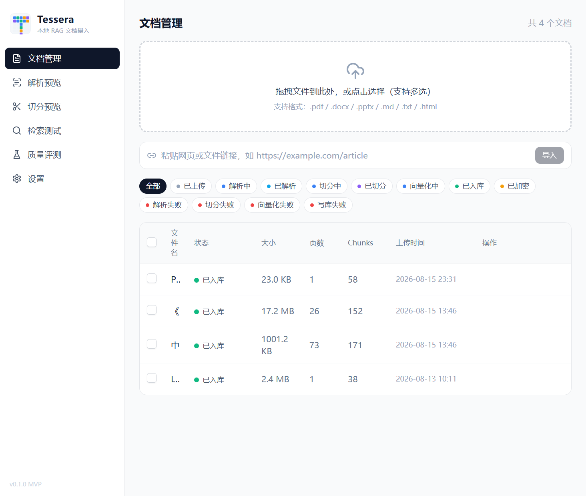
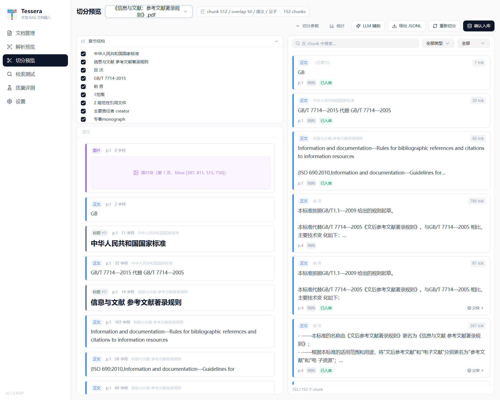
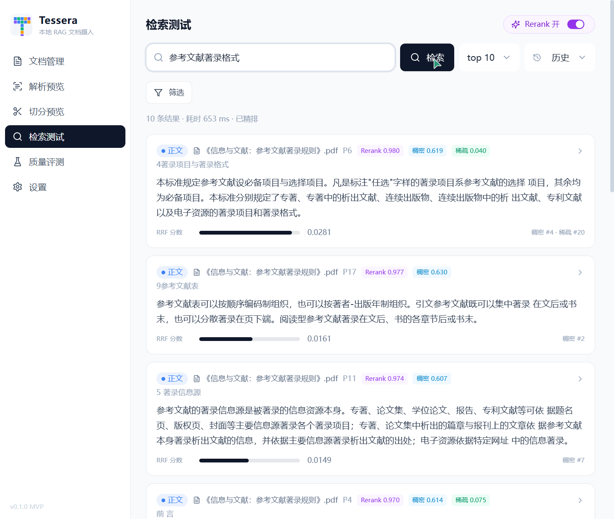

# Tessera

> 本地 RAG 文档摄入工具：多格式解析 → 八阶段智能切分 → 向量化 → 混合检索验证 → 训练数据导出。
> 一切围绕一个目标——**让「文档切得好不好、检索准不准」变得可见、可调、可验证**。

[](https://github.com/Yaoyao23238/Tessera_RAG/actions/workflows/ci.yml)


## 为什么做 Tessera

RAG 的效果瓶颈几乎都在摄入环节：解析丢字、切分碎裂、检索噪声——但主流工具把这三步做成
黑盒，坏了也不知道坏在哪。Tessera 把它们做成**可视化、可调参、可评测**的流水线：

- **切分可视化预览**：左侧原文、右侧 chunk 卡片联动，切坏了当场看得见
- **八阶段混合切分**：结构聚合 → 段落/语义/递归拆分 → 过小碎片合并 → 空信息过滤 →
  overlap → 小块合并 → Parent-Child，每个参数的效果可 A/B 对比
- **混合检索全链路可观测**：稠密 + 稀疏（BM25）→ RRF 融合 → Rerank 精排 + 相关性阈值，
  每个结果展示各通道原始分，诊断"为什么是这条"不再靠猜
- **质量评测闭环**：QA 测试集 → 实验（独立索引）→ Recall@k / MRR，切分参数好坏用数字说话
- **训练数据导出**：alpaca / Dify JSONL，带 AI 思维链清洗（剥离「推理过程」只留回复正文）

## 界面预览

| 文档管理 | 切分预览 | 检索测试 |
|---|---|---|
|  |  |  |

## 核心能力

| 能力 | 说明 |
|---|---|
| 文档解析 | PDF（分批转换防内存耗尽）/ DOCX / PPTX / MD / TXT / HTML，扫描件 OCR（RapidOCR），TXT 编码自动检测，URL 导入 |
| 解析验收 | 章节树/表格/图片块预览、质量报告、LLM 清洗（off/problem/full 三档） |
| 切分引擎 | 八阶段混合切分 + Parent-Child，12 项参数全部进 config_hash（改参必重切，不命中旧缓存） |
| 向量化 | BGE-M3（稠密+稀疏）/ Qwen3-Embedding / OpenAI 兼容 API，批量编码 + embedding 缓存 |
| 混合检索 | 稠密 ANN + BM25（CJK 二元分词）→ RRF(k=60) → bge-reranker-v2-m3 精排 + min_score 阈值，支持按文档/类型过滤 |
| 质量评测 | QA 测试集管理（导入/LLM 生成）、实验对比回归、Recall@1/5/10 + MRR |
| 导出 | alpaca / Dify JSONL，章节过滤、思维链清洗 |
| 存储 | LanceDB（默认）/ sqlite-vec（兜底自动降级）/ Qdrant / pgvector（后两档未联调，UI 有警示） |

## 快速开始

**环境要求**：Python 3.10+（开发用 3.13）· Node 18+ · GPU 可选（CUDA 加速解析/向量化，纯 CPU 亦可跑）。
依赖含 torch / docling 等大件（数 GB），`pip install` 需要几分钟。

```bash
# 后端（端口 8766）
cd backend
pip install -e ".[dev]"
python -m uvicorn app.main:app --host 127.0.0.1 --port 8766

# 前端（端口 5173，另开终端）
cd frontend
npm install
npm run dev
```

打开 http://localhost:5173/ 。首次使用时 embedding 模型（BGE-M3，约 2.2GB）按需下载，
下载源可在设置页切换（huggingface / hf-mirror / ModelScope）。模型就绪状态见
`GET /api/health` 的 `models` 字段。

> docker-compose.yml 提供容器化部署（端口 8766），**尚未实测验证**，欢迎提 issue。

## 测试

```bash
cd backend && python -m pytest -q     # 294 passed + 3 skipped
cd frontend && npx tsc -b              # 类型检查零错误
```

测试为真实集成测试（真实 LanceDB / sqlite-vec / 临时 SQLite），core 层 fake 注入不依赖模型。
3 个 skipped 为在线评测回归门（需 `TESSERA_API` 环境变量指向运行中的服务）。

## 文档导航

| 文档 | 内容 | 适合谁看 |
|---|---|---|
| [PRD.md](PRD.md) | 需求与产品定义 | 想了解"做什么、为什么" |
| [ARCHITECTURE.md](ARCHITECTURE.md) | 架构设计（数据模型/切分算法/检索链路/缓存） | 想了解"怎么做的" |
| [DESIGN.md](DESIGN.md) | 模块设计与接口定义（类图/时序） | 想看模块协作细节 |
| [PAIN_POINTS.md](PAIN_POINTS.md) | 真实 bug 的现象/根因/解决/教训 | 想看踩坑与排查过程 |
| [PROGRESS.md](PROGRESS.md) | 当前状态、规划与近期进展 | 想接手/跟进 |
| [docs/progress-archive.md](docs/progress-archive.md) | 历史进展归档 | 回查历史 |
| [MODEL_DOWNLOAD.md](MODEL_DOWNLOAD.md) | 模型下载操作手册 | 部署/离线环境 |

## 已知边界

- Qdrant / pgvector 档位代码路径已实现但**未做真实服务联调**（设置页有警示）
- Docker Compose 未实测
- 图片理解（VLM 生成描述入库）在规划中，当前空图片块默认不入库（可关）
- 单知识库、单用户设计

## License

[MIT](LICENSE)
